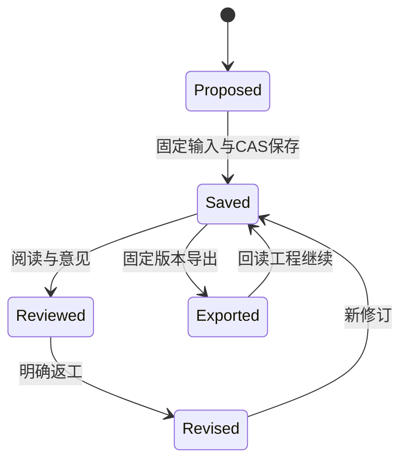

# 领域与本体设计

## 领域边界

作者真相是专业设定候选，不自动成为宿主正典。confirmed仅表示本工程声明的线索可靠度；结构一致不证明诡计公平、读者一定猜出或现实案件结论。复用小说规划的时序与人物知情，不建立第二份正式时间线。

| Owner | 拥有的事实 |
| --- | --- |
| 河图Core | WorkRef、固定来源、专业对象修订、CAS、原操作、正式正文及作者决定 |
| 本插件 | 专业结构、计算、专业偏好、视图与可再生成导出 |
| 外部Agent | 理解、规划、内容生成与方法执行 |
| 作者 | 取舍、采纳、定稿、内容外发和费用决定 |

## 核心本体

| 对象 | 存储集合 | 创作含义 |
| --- | --- | --- |
| proposition | propositions | 命题 |
| witness | witnesses | 证人 |
| clue | clues | 线索 |
| testimony | testimonies | 证词 |
| hypothesis | hypotheses | 假说 |
| stage | stages | 揭示阶段 |

所有局部ID只在当前专业工程中有意义；同名、同ID或相同版本号不能跨作品推定身份。引用正文时固定UTF-8字节区间与原引文；引用媒体时固定宿主素材修订和摘要。

## 关系与不变量

proposition 1—N clue；witness 1—N testimony N—1 proposition；hypothesis N—N proposition；stage N—N clue。

每个集合ID唯一，外键必须存在；删除仍被使用的对象拒绝保存。全对象更新与细粒度动作遵循同一校验，不存在绕过领域规则的编辑入口。来源更新先说明影响，再明确建立新修订。专业选中状态不扩大成宿主选用或作者定稿。

## 领域推断的证据边界

读者视角绝不返回作者真值、未揭示命题或未来线索文本

支持、反驳、同时冲突、仅传闻及完全未知分别报告

同一线索可在多个阶段出现，首次揭示确定且阶段顺序唯一

假说有未满足前提时不能声称排除或唯一解

证词保留原话、固定引文准确、更新后旧工程保持

## 专业对象状态

此状态图描述工作旅程，不新增重复的数据库状态机。正文采纳与定稿由宿主另行处理。
