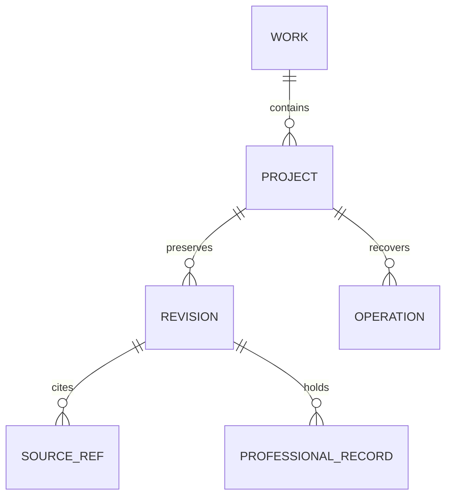
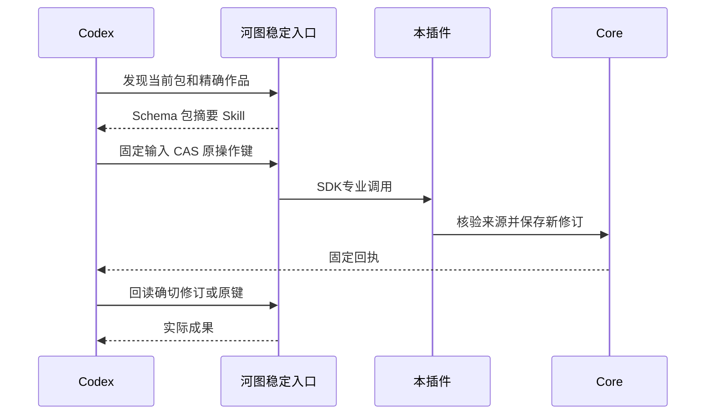

# 数据与API设计

## 数据格式

宿主包外壳按其Draft-07清单校验；专业数据与动作由Ajv2020独立校验，两者不混用。唯一可执行Schema是[包清单](../contracts/plugin-manifest.json)，`additionalProperties=false`拒绝拼错字段。`format_version=1`，Schema版本`1.0.0`；升级不得裁掉新字段覆盖旧数据。

| 根字段 | 类型 | 必填 |
| --- | --- | --- |
| format_version | constant | 是 |
| title | string | 是 |
| basis_refs | array | 是 |
| propositions | array | 是 |
| witnesses | array | 是 |
| clues | array | 是 |
| testimonies | array | 是 |
| hypotheses | array | 是 |
| stages | array | 是 |

### 命题 `propositions`

| 字段 | 类型／范围 |
| --- | --- |
| id | `{"type":"string","minLength":1,"maxLength":100}` |
| statement | `{"type":"string","minLength":1,"maxLength":8000}` |
| author_truth | `{"enum":["true","false","unknown"]}` |
| ranges | `{"type":"array","items":{"type":"object","additionalProperties":false,"properties":{"source_index":{"type":"integer","minimum":0,"maximum":99},"byte_start":{"type":"integer","minimum":0,"maximum":100000000},"byte_end":{"type":"integer","minimum":0,"maximum":100000000},"quote":{"type":"string","minLength":0,"maxLength":16000}},"required":["source_index","byte_start","byte_end","quote"]},"maxItems":100}` |

### 证人 `witnesses`

| 字段 | 类型／范围 |
| --- | --- |
| id | `{"type":"string","minLength":1,"maxLength":100}` |
| name | `{"type":"string","minLength":1,"maxLength":200}` |
| notes | `{"type":"string","minLength":0,"maxLength":4000}` |

### 线索 `clues`

| 字段 | 类型／范围 |
| --- | --- |
| id | `{"type":"string","minLength":1,"maxLength":100}` |
| title | `{"type":"string","minLength":1,"maxLength":200}` |
| proposition_id | `{"type":"string","minLength":1,"maxLength":100}` |
| polarity | `{"enum":["supports","refutes"]}` |
| reliability | `{"enum":["confirmed","claimed","unknown"]}` |
| ranges | `{"type":"array","items":{"type":"object","additionalProperties":false,"properties":{"source_index":{"type":"integer","minimum":0,"maximum":99},"byte_start":{"type":"integer","minimum":0,"maximum":100000000},"byte_end":{"type":"integer","minimum":0,"maximum":100000000},"quote":{"type":"string","minLength":0,"maxLength":16000}},"required":["source_index","byte_start","byte_end","quote"]},"maxItems":100}` |

### 证词 `testimonies`

| 字段 | 类型／范围 |
| --- | --- |
| id | `{"type":"string","minLength":1,"maxLength":100}` |
| witness_id | `{"type":"string","minLength":1,"maxLength":100}` |
| statement | `{"type":"string","minLength":1,"maxLength":8000}` |
| proposition_id | `{"type":"string","minLength":1,"maxLength":100}` |
| asserts | `{"type":"boolean"}` |
| clue_ids | `{"type":"array","items":{"type":"string","minLength":1,"maxLength":100},"maxItems":100}` |

### 假说 `hypotheses`

| 字段 | 类型／范围 |
| --- | --- |
| id | `{"type":"string","minLength":1,"maxLength":100}` |
| title | `{"type":"string","minLength":1,"maxLength":200}` |
| requirements | `{"type":"array","items":{"type":"object","additionalProperties":false,"properties":{"proposition_id":{"type":"string","minLength":1,"maxLength":100},"value":{"type":"boolean"}},"required":["proposition_id","value"]},"maxItems":100}` |

### 揭示阶段 `stages`

| 字段 | 类型／范围 |
| --- | --- |
| id | `{"type":"string","minLength":1,"maxLength":100}` |
| title | `{"type":"string","minLength":1,"maxLength":200}` |
| order | `{"type":"integer","minimum":0,"maximum":1000000}` |
| clue_ids | `{"type":"array","items":{"type":"string","minLength":1,"maxLength":100},"maxItems":500}` |

## 数据库与持久化

本包不新增SQLite或第二个作品数据库。使用公开SDK的ProjectStore保存`mystery_lab`专业对象。宿主保存不可变修订，插件只提交内容和固定来源。

| 逻辑记录 | 主键／关系 | 维护Owner |
| --- | --- | --- |
| 专业对象 | WorkRef＋Owner＋object_id | Core |
| 专业修订 | object_id＋revision，sha256，previous_sha256 | Core |
| 操作回执 | 工作区＋Owner＋operation_key | Core |
| 专业内容 | 上述根对象及集合局部ID | 本包 |
| 来源／专业依据 | 固定WorkRef、修订与摘要 | 原Owner |

## 公开API

Codex先调用河图实际能力发现，再用`hetu.plugins.capabilities`取得本包Schema和摘要，最终通过`hetu.plugins.invoke`调用。绑定精确WorkRef、management_ref、plugin_id、package_sha256及capabilities_sha256；不将路径或标题当身份。

| 动作 | 用途 | 效果 |
| --- | --- | --- |
| list_projects | 查找专业工程 | read |
| get_project | 读取固定专业工程 | read |
| save_project | 保存专业工程 | managed_write |
| put_proposition | 维护命题 | managed_write |
| remove_proposition | 移除命题 | managed_write |
| put_witness | 维护证人 | managed_write |
| remove_witness | 移除证人 | managed_write |
| put_clue | 维护线索 | managed_write |
| remove_clue | 移除线索 | managed_write |
| put_testimony | 维护证词 | managed_write |
| remove_testimony | 移除证词 | managed_write |
| put_hypothesis | 维护假说 | managed_write |
| remove_hypothesis | 移除假说 | managed_write |
| put_stage | 维护揭示阶段 | managed_write |
| remove_stage | 移除揭示阶段 | managed_write |
| reader_view | 读取阶段读者视角 | read |
| evaluate_hypotheses | 按可见线索评估假说 | read |
| check_mystery | 检查证据与揭示结构 | read |
| compare_stages | 比较揭示前后信息 | read |
| locate_clue | 定位线索原文 | read |
| get_source | 读取固定来源 | read |
| get_basis | 读取固定专业依据 | read |
| compare_versions | 比较固定修订 | read |
| export_project | 导出固定专业报告 | read |
| build_context | 准备有界创作上下文 | read |
| create_handoff | 准备精确AI交接 | read |
| get_operation | 回读原操作 | read |

逐字段参数归清单，生成的[功能清单](../CAPABILITIES.md)和[方法操作地图](../skills/hetu-mystery-lab/references/operations.md)提供导航。

## 写入与错误

新建使用expected_revision=0和空expected_sha256；更新使用回读的确切修订和摘要，所有写入携带原operation_key。同键同输入回读原成果，同键不同输入拒绝；冲突保留输入。错误包括invalid_input、revision_conflict、idempotency_conflict、not_found和hetu.budget_exceeded，以实际宿主回执为准。

导出按固定对象分块，核对offset、总长度、分块与完整SHA-256。UTF-8分块不能切断字符，二进制不经字符串转码。
